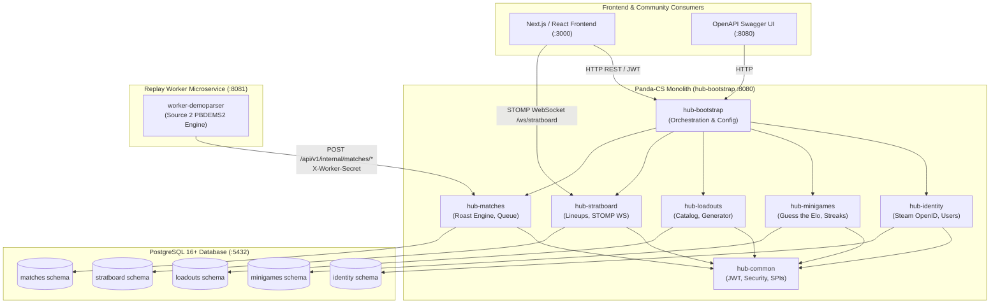

# Panda-CS (`cs2-superhub`)

[](https://github.com/Mirmukhsin/panda-cs/actions/workflows/ci.yml)
[](https://adoptium.net/)
[](https://spring.io/projects/spring-boot)
[](https://www.postgresql.org/)
[](https://opensource.org/licenses/MIT)

> **Panda-CS** is an all-in-one Counter-Strike 2 web platform built as a **Strict Modular Monolith** in Java 21 & Spring Boot 3.4, complemented by a dedicated, decoupled **Demo Parser Worker Microservice** for asynchronous Source 2 `.dem` replay telemetry analysis.

---

## 🎮 The 4-in-1 Super-Hub Capabilities

```
                                  ┌───────────────────────────────┐
                                  │      Panda-CS Super-Hub       │
                                  └──────────────┬────────────────┘
                 ┌───────────────────┬───────────┴───────────┬───────────────────┐
                 ▼                   ▼                       ▼                   ▼
        ┌─────────────────┐ ┌─────────────────┐     ┌─────────────────┐ ┌─────────────────┐
        │ Daily Minigames │ │ Budget Loadouts │     │   Stratboard    │ │  Roast & Flex   │
        │ Guess the Elo   │ │ & Sticker Craft │     │ Real-Time STOMP │ │ Match Analyzer  │
        └─────────────────┘ └─────────────────┘     └─────────────────┘ └─────────────────┘
```

1. **Daily "Guess the Elo" Premier Minigames (`hub-minigames`)**
   - Community-submitted CS2 gameplay clips with YouTube/Twitch/Medal embeds.
   - Moderator approval queue with role-based access control (`ROLE_MODERATOR`, `ROLE_ADMIN`).
   - Daily cron challenge rotation (`0 0 * * *`) generating a single global daily challenge.
   - Deterministic rating-difference scoring algorithm awarding up to 1,000 points (`BULLSEYE` 🟢, `CLOSE` 🟡, `OFF` 🔴) with daily streaks.
   - Redis-ready global and daily leaderboards.

2. **Color-Matched Budget Loadout Generator & Sticker Crafts (`hub-loadouts`)**
   - Live synchronization engine with `ByMykel/CSGO-API` (33+ curated weapons and 10+ stickers with instant fallback seeding).
   - Greedy knapsack budget allocation algorithm generating competitive 5-weapon loadouts under user-specified USD caps (`$50`, `$150`, `$500`, `$1,000+`).
   - Aesthetic color-harmony matching bonuses (`RED`, `BLUE`, `PURPLE`, `GREEN`, `YELLOW`, `WHITE`, `BLACK`).
   - Community loadout curation, persistent upvote deduplication, and custom 4-slot/5-slot sticker crafts.

3. **Stratboard & Collaborative Real-Time Tactics Canvas (`hub-stratboard`)**
   - Curated CS2 utility lineup library (smokes, flashes, molotovs, HE) across Active Duty maps (`de_mirage`, `de_inferno`, `de_dust2`, `de_nuke`, etc.) with normalized coordinates (`0.0`–`100.0`) and throw techniques (`JUMP_THROW`, `RUN_THROW`).
   - Saved tactical playbooks with shareable 8-character codes (`shareCode`).
   - Real-time collaborative 2D whiteboard rooms powered by Spring WebSockets (STOMP over SockJS) synchronizing freehand sketches, utility pins, player tokens, and laser cursors.

4. **Automated "Roast & Flex" Match Analyzer (`hub-matches` & `worker-demoparser`)**
   - Automated ingestion of Valve 34-character CS2 Match Share Codes (`CSGO-xxxxx-xxxxx-xxxxx-xxxxx-xxxxx`) or `.dem` replay URLs.
   - Asynchronous daemon architecture: `worker-demoparser` polls queued jobs, validates Source 2 `PBDEMS2` magic headers, extracts telemetries, and **strictly enforces ephemeral replay cleanup on disk**.
   - Deterministic **Roast & Flex Badge Engine** awarding 10 signature community badges (`The Backpack`, `Master Baiter`, `Eco Cobra`, `The Crutch`, `Ice in Veins`, `Flashbang Fiend`, `First Blood Victim`, `AFK Spectator`, etc.).
   - Shareable viral player roast cards and developer instant simulation mode (`/simulate`).

---

## 🏗️ Architecture & Module Inventory

The backend follows a strict **Modular Monolith** architecture with strict schema segregation and bounded context enforcement.



### Module Directory

| Module | Responsibilities | Database Schema | Port |
|---|---|---|---|
| **`hub-common`** | JWT token provider (`HS256`), Security filters, Global exception handlers, SPI interfaces (`UserLookupService`), OpenAPI config. | Shared library | — |
| **`hub-identity`** | Steam OpenID 2.0 authentication, dev mock login, JWT token issuance, user profile management. | `identity` | — |
| **`hub-minigames`** | Clip submission, admin moderation, daily Elo challenge cron, scoring engine, leaderboards. | `minigames` | — |
| **`hub-loadouts`** | CS2 skin & sticker catalog sync (`ByMykel/CSGO-API`), Color-Matched Budget Generator, community crafts & upvotes. | `loadouts` | — |
| **`hub-stratboard`** | Curated grenade lineup library, saved tactical playbooks, real-time STOMP WebSocket whiteboard rooms (`/ws/stratboard`). | `stratboard` | — |
| **`hub-matches`** | Valve share code ingestion, worker job queue, "Roast & Flex" badge calculations, player roast cards, match simulation. | `matches` | — |
| **`hub-bootstrap`** | Main runtime entrypoint (`Cs2SuperHubApplication`), centralized configuration, Flyway schema migrations runner. | All schemas | `8080` |
| **`worker-demoparser`** | Standalone worker daemon for replay downloading, `PBDEMS2` validation, ephemeral cleanup, and telemetry delivery. | None (Decoupled) | `8081` |

### Architectural Boundaries & Invariants
- **No Cross-Module JPA Entity or Repository Imports**: Feature modules depend solely on `hub-common`. Inter-module communications occur strictly via Spring application events or SPI service contracts (`UserLookupService`).
- **Strict Database Schema Segregation**: Each domain owns an independent PostgreSQL schema (`identity`, `minigames`, `loadouts`, `stratboard`, `matches`). No cross-schema foreign keys or joins exist; cross-boundary references use scalar `UUID` identifiers.
- **Immutable DTOs via Java Records**: All request payloads, response envelopes (`ApiResponseDto<T>`), and event records are immutable Java records.

---

## 📜 API Contracts for Frontend Developers

Full markdown specifications with exhaustive endpoint parameters, request/response JSON schemas, and WebSocket topics are documented in the [`/contracts`](contracts/README.md) directory:

- 🔑 [**Identity & Auth API Contract**](contracts/identity-api.md) — Steam OpenID 2.0 flow, Dev Mock login, JWT token structure, and user profiles.
- 🎯 [**Minigames & Elo API Contract**](contracts/minigames-api.md) — Daily Guess the Elo challenges, clip submission, moderation queue, and leaderboards.
- 🎨 [**Loadouts & Generator API Contract**](contracts/loadouts-api.md) — Skin search, Budget Loadout Generator, upvote deduplication, and sticker crafts.
- 🗺️ [**Stratboard & WebSocket API Contract**](contracts/stratboard-api.md) — Utility lineup library, tactics playbooks, and STOMP WebSocket whiteboard frame protocols.
- 🏆 [**Matches & Roast Engine API Contract**](contracts/matches-api.md) — Match submission, simulator (`/simulate`), roast cards, and complete 12-badge reference table.

---

## 🚀 Quickstart & Running Locally

### Prerequisites
- **Java 21** (JDK 21+)
- **Maven 3.9+**
- **Docker & Docker Compose**
- **PostgreSQL 16+** (if running outside Docker)

### Option 1: Full-Stack Docker Deployment (Recommended)

Bring up the complete backend (PostgreSQL, Monolith API, and Demo Parser Worker) with a single command:

```bash
docker compose -f docker-compose.full.yml up --build -d
```

- **Monolith API Gateway:** `http://localhost:8080`
- **Swagger UI:** `http://localhost:8080/swagger-ui.html`
- **OpenAPI v3 JSON:** `http://localhost:8080/v3/api-docs`
- **Replay Parser Daemon:** `http://localhost:8081`
- **PostgreSQL Database:** `localhost:5432` (database: `cs2hub`)

To stop the containers:
```bash
docker compose -f docker-compose.full.yml down
```

---

### Option 2: Local Development Run (Maven)

#### 1. Start PostgreSQL
```bash
docker compose up -d postgres
```

#### 2. Run Monolith API (`hub-bootstrap`)
```bash
# Windows PowerShell
$env:DB_USER="postgres"; $env:DB_PASSWORD="your_password"; mvn spring-boot:run -pl hub-bootstrap

# Linux / macOS
DB_USER=postgres DB_PASSWORD=your_password mvn spring-boot:run -pl hub-bootstrap
```
The server will start on port `8080`. Flyway will automatically create and migrate all 5 schemas (`identity`, `minigames`, `loadouts`, `stratboard`, `matches`), and initial catalog/lineup seeds will populate.

#### 3. Run Demo Parser Worker (`worker-demoparser`)
In a second terminal:
```bash
mvn spring-boot:run -pl worker-demoparser
```
The worker daemon will boot on port `8081` and poll `http://localhost:8080/api/v1/internal/matches/claim-next`.

---

## 🛠️ Developer Productivity Helpers

### 1. Instant Dev Mock Login
Bypass Steam OpenID redirection during local frontend development:
```bash
curl -X POST http://localhost:8080/api/v1/auth/dev-login \
  -H "Content-Type: application/json" \
  -d '{
    "steamId": "76561198000000001",
    "username": "DevPlayer",
    "role": "ADMIN"
  }'
```

### 2. Instant Match Simulator
Generate an analyzed match with 10 archetype players and awarded badges in 1 millisecond without needing a `.dem` file:
```bash
curl -X POST http://localhost:8080/api/v1/matches/simulate \
  -H "Content-Type: application/json" \
  -d '{"shareCode": "CSGO-DEMO-SIM-001", "mapName": "de_mirage"}'
```

---

## ⚙️ Configuration & Environment Variables

| Variable | Description | Default |
|---|---|---|
| `SERVER_PORT` | HTTP port for `hub-bootstrap` | `8080` |
| `DB_HOST` | PostgreSQL hostname | `localhost` |
| `DB_PORT` | PostgreSQL port | `5432` |
| `DB_USER` | PostgreSQL user | `postgres` |
| `DB_PASSWORD` | PostgreSQL password | `postgres` |
| `STEAM_API_KEY` | Valve Steam Web API Key | `""` (Dev mode supported) |
| `STEAM_REALM` | Steam OpenID Realm | `http://localhost:8080` |
| `FRONTEND_AUTH_REDIRECT` | Post-login frontend redirect URL | `http://localhost:3000/auth/callback` |
| `AUTH_DEV_MODE` | Enables `/api/v1/auth/dev-login` | `true` |
| `WORKER_SHARED_SECRET` | Secret key for worker daemon authentication | `dev-worker-secret-key` |
| `HUB_BASE_URL` | Monolith URL configured in `worker-demoparser` | `http://localhost:8080` |
| `WORKER_POLL_INTERVAL_MS`| Worker replay polling frequency | `5000` |

---

## 🧪 Testing

Run unit and integration tests across all 9 modules:
```bash
mvn clean test
```

Execute tests for a specific module:
```bash
mvn test -pl hub-matches
mvn test -pl worker-demoparser
```

---

## 📄 License

This project is licensed under the [MIT License](LICENSE).
Counter-Strike, CS:GO, and CS2 are trademarks and/or registered trademarks of Valve Corporation. This project is an independent community platform not affiliated with or endorsed by Valve Corporation.
